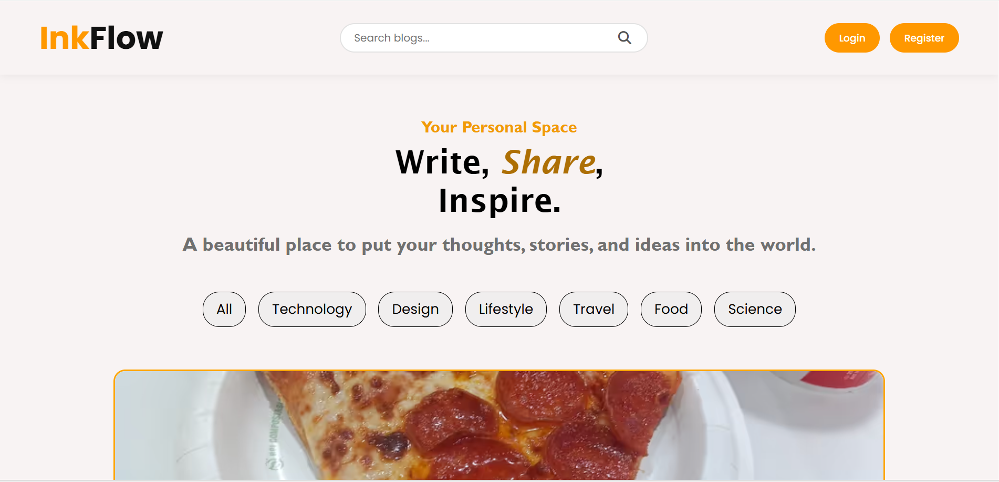
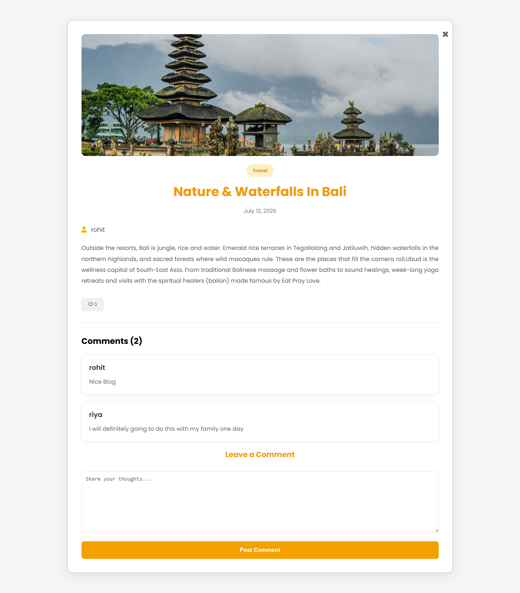
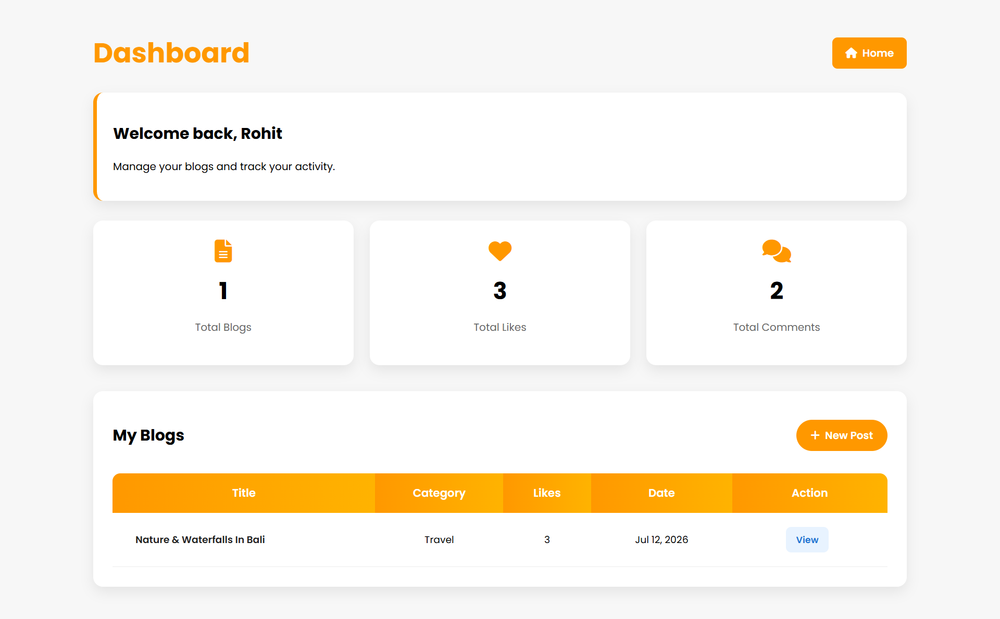
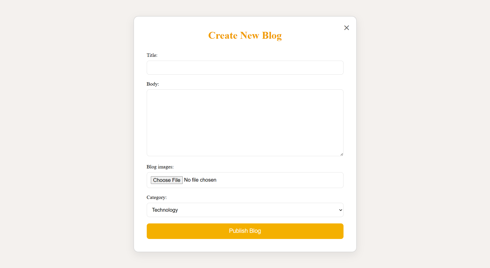

<h1 align="center">✍️ InkFlow</h1>

<p align="center"> A modern full-stack blogging platform built with <strong>Django</strong> featuring user authentication, blog management, likes, comments, responsive design, Cloudinary media storage, and Render deployment. </p>

<h2>📌 Table of Contents</h2>
<p align="center">
<a href="#live-demo">Live Demo</a> •
<a href="#features">Features</a> •
<a href="#tech-stack">Tech Stack</a> •
<a href="#project-structure">Project Structure</a> •
<a href="#screenshots">Screenshots</a> •
<a href="#installation">Installation</a> •
<a href="#what-i-learned">What I Learned</a> •
<a href="#author">Author</a>
</p>

---

<h2 id="live-demo">🌐 Live Demo</h2>

https://inkflow-django-blog.onrender.com

**Note:** The application is hosted on Render’s free tier, so the first load may take **30–60 seconds** while the server wakes up.The production PostgreSQL database is hosted on Neon.


---

<h2 id="features">Features</h2>

<h3>User Authentication</h3>

- User Registration
- User Login
- User Logout
- Secure Authentication using Django Authentication System


<h3>Blog Management</h3>

- Create Blog Posts
- Edit Own Blogs
- Delete Own Blogs
- Upload Blog Images
- Categorize Blogs
- Rich Blog Detail Page


<h3>User Interaction</h3>

- Like / Unlike Blogs (AJAX)
- Live Like Counter
- Add Comments
- Edit Comments Without Reload (AJAX)
- Delete Own Comments


<h3>Search & Filter</h3>

- Search Blogs by Title
- Search Blogs by Content
- Filter Blogs by Category


<h3>Dashboard</h3>

- View Personal Blogs
- Total Blogs
- Total Likes
- Total Comments


<h3>Popular Posts</h3>

- Displays Top 3 Most Liked Blogs


<h3>Responsive Design</h3>

- Desktop
- Laptop
- Tablet
- Mobile

---

<h2 id="tech-stack"> Tech Stack</h2>

### Backend

- Python
- Django

### Frontend

- HTML5
- CSS3
- JavaScript

### Database

- Neon PostgreSQL – Production database (managed PostgreSQL)
- SQLite (Local Development)

### Other Technologies

- Neon (Managed PostgreSQL Database)
- Cloudinary (Cloud Image Storage)
- Django Authentication
- AJAX (Fetch API)
- Font Awesome
- Google Fonts (Poppins)
- Render (Deployment)

---

<h2 id="project-structure"> Project Structure</h2>

```text
InkFlow/
│
├── accounts/
│
├── blogapp/
│   ├── migrations/
│   ├── static/
│   │   ├── css/
│   │   ├── images/
│   │   └── js/
│   ├── templates/
│   │   └── blogapp/
│   ├── forms.py
│   ├── models.py
│   ├── views.py
│   └── ...
│
├── blogproject/
│   ├── settings.py
│   ├── urls.py
│   ├── asgi.py
│   └── wsgi.py
│
├── media/
│
├── screenshots/
│   ├── home.png
│   ├── detail.png
│   ├── dashboard.png
│   └── create.png
│
├── .gitignore
├── manage.py
├── README.md
└── requirements.txt
```

---

<h2>Main Functionalities</h2>

<h3>Home Page</h3>

- Displays all blogs
- Search functionality
- Category filtering
- Popular posts section


<h3>Blog Detail Page</h3>

- Blog Image
- Author Information
- Like Button
- Live Like Counter
- Comment Section
- Inline Comment Editing
- Responsive Layout


<h3>Dashboard</h3>

- Personal Blog Management
- Blog Statistics
- Total Likes
- Total Comments

---

<h2 id="screenshots">Screenshots</h2>

<h3>Home Page</h3>

<br>

<p align="center">

</p>

<br><br>

---

<h3>Blog Detail Page</h3>

<br>

<p align="center">

</p>

<br><br>

---

<h3>Dashboard</h3>

<br>

<p align="center">

</p>

<br><br>

---

<h3>Create Blog</h3>

<br>

<p align="center">

</p>

<br>

---

<h2 id="installation">Installation</h2>

<h3>1. Clone the Repository</h3>

```bash
git clone https://github.com/vaidyajanhavi13-bot/inkflow-django-blog.git
```

<h3>2. Navigate to the Project Folder</h3>

```bash
cd inkflow-django-blog
```

<h3>3. Create a Virtual Environment</h3>

```bash
python -m venv venv
```

<h3>4. Activate the Virtual Environment</h3>

<strong>Windows</strong>

```bash
venv\Scripts\activate
```

<strong>Linux / macOS</strong>

```bash
source venv/bin/activate
```

<h3>5. Install Dependencies</h3>

```bash
pip install -r requirements.txt
```

<h3>6. Apply Database Migrations</h3>

```bash
python manage.py migrate
```

<h3>7. Start the Development Server</h3>

```bash
python manage.py runserver
```

Open your browser and visit:

```text
http://127.0.0.1:8000/
```

---

<h2 id="what-i-learned">What I Learned</h2>

While building InkFlow, I gained practical experience with:

- Django Class-Based Views
- Django Authentication
- CRUD Operations
- Model Relationships
- AJAX using Fetch API
- Responsive Web Design
- Cloudinary Media Storage
- PostgreSQL Integration
- Media File Uploads
- Search and Filtering
- Dashboard Development
- Environment Variable Management
- Git & GitHub
- Neon PostgreSQL Database Integration
- Connecting Django Applications to Cloud-Hosted Databases
- Deploying Django Applications on Render


---

<h2 id="author">Author</h2>

<strong>Janhavi Vaidya</strong>

<a href="https://github.com/vaidyajanhavi13-bot">
GitHub Profile
</a>
<br>


---
